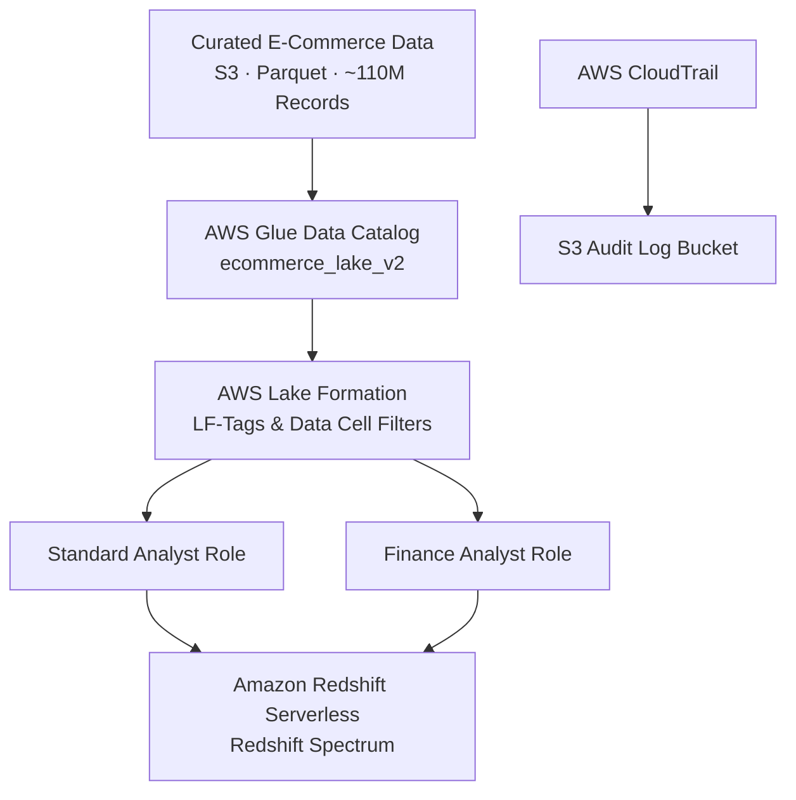

# Enterprise E-Commerce Data Lakehouse & Governance

A Terraform-managed AWS data lakehouse that implements **column-level security, data governance, serverless analytics, and audit logging** across a curated e-commerce dataset containing approximately **110 million behavioral records**.

Built on curated data from an upstream [AWS Serverless E-Commerce ETL Pipeline](https://github.com/mismael04/ecommerce-serverless-pipeline), this project focuses on the analytics and governance layer: registering data in the AWS Glue Data Catalog, enforcing role-based access through AWS Lake Formation, querying data with Amazon Redshift Serverless, and recording account activity with AWS CloudTrail.

## Key Features

- **110M+ behavioral records:** Supports analytics on a large-scale e-commerce events dataset.
- **PII column-level filtering:** Uses AWS Lake Formation data cell filters to prevent standard analysts from accessing `user_id`.
- **Role-based data access:** Separates standard analytics access from broader finance analyst access.
- **Serverless analytics:** Queries curated data through Amazon Redshift Serverless and Redshift Spectrum.
- **Infrastructure as Code:** Provisions AWS resources and permissions using Terraform.
- **Governance tagging:** Applies Lake Formation tags to classify data by department and sensitivity.
- **Audit logging:** Configures a multi-region AWS CloudTrail trail with log file validation and centralized S3 storage.
- **Data quality checks:** Includes SQL checks for missing values, invalid prices, and unexpected event types.

## Architecture



The project assumes the upstream ETL pipeline has already produced curated Parquet data in S3 and registered the relevant table in the Glue Data Catalog. Terraform then provisions the governance, analytics, and audit resources around that data.

## Technology Stack

| Category | Technologies |
|---|---|
| Infrastructure as Code | Terraform |
| Cloud platform | AWS |
| Data governance | AWS Lake Formation, LF-Tags, data cell filters |
| Data catalog | AWS Glue Data Catalog |
| Analytics | Amazon Redshift Serverless, Redshift Spectrum |
| Storage | Amazon S3 |
| Auditing | AWS CloudTrail |
| Data validation | SQL |

## Governance and Access Control

This project demonstrates how different analyst roles can access the same underlying dataset with different permissions.

### Standard Analyst

The standard analyst role is `redshift-lakeformation-execution-role`.

- Uses the `external_standard_schema` schema.
- Receives metadata access and filtered table access through Lake Formation.
- Uses the `exclude_pii_user_id_filter` data cell filter, which excludes the `user_id` column.
- Can query approved behavioral data without being granted access to that identifier through the intended Lake Formation access path.

### Finance Analyst

The finance analyst role is `finance-analyst-execution-role`.

- Uses the `external_finance_schema` schema.
- Receives broader table permissions through Lake Formation.
- Can access `user_id` and other table columns for authorized analytical use cases.

**Security objective:** Apply least-privilege access so that analysts receive only the data their roles are authorized to use.

The effective permissions should be validated end to end in AWS. IAM permissions, Redshift access, and Lake Formation permissions must work together for the intended column filter to be enforced.

## Lake Formation Tag-Based Governance

Terraform configures Lake Formation tags to classify data across two dimensions:

| Tag | Values |
|---|---|
| `department` | `analytics`, `finance` |
| `sensitivity` | `restricted`, `public` |

These tags provide a foundation for organizing data permissions around business roles and sensitivity classifications rather than managing every permission independently.

The project also registers the curated S3 location with Lake Formation and associates governance metadata with the Glue Data Catalog table in `ecommerce_lake_v2`.

## Serverless Analytics

Amazon Redshift Serverless is provisioned with:

- Namespace: `enterprise-analytics-namespace`
- Database: `ecommerce_warehouse`
- Workgroup: `enterprise-analytics-workgroup`
- Base capacity: 8 Redshift Processing Units (RPUs)
- IAM roles for standard and finance analyst access

Redshift Spectrum enables queries against the cataloged S3 data without requiring the curated dataset to be loaded into local Redshift tables.

The repository includes SQL examples for creating external schemas with the corresponding IAM roles and querying the governed data.

## Audit Logging

AWS CloudTrail is configured to record account activity and deliver logs to a dedicated S3 bucket.

The audit configuration includes:

- Multi-region trail.
- Global service events.
- Log file validation.
- S3 public access blocking.
- Server-side encryption using AES-256.
- Bucket ownership controls and a private ACL configuration.
- A bucket policy allowing CloudTrail to deliver logs.

This provides an audit trail for investigating account activity and supporting governance reviews. Log file validation helps detect changes to delivered log files; it does not by itself make the logs immutable.

## Data Quality Checks

The `src/data_quality_checks.sql` file contains SQL checks against the finance external schema.

### Completeness

Counts records with missing values in important fields:

- `event_time`
- `event_type`
- `product_id`
- `user_id`
- `price`

### Price validation

Checks for records with negative prices.

### Event type validation

Checks for event types outside the expected set:

- `view`
- `cart`
- `remove_from_cart`
- `purchase`

### Dataset profiling

Includes aggregate checks for total rows, distinct users, and distinct sessions.

These checks provide a starting point for validating the data exposed through the governed analytics layer.

## Sample Queries

The `src/sample_queries.sql` file demonstrates how to create external schemas for the two analyst roles and query the cataloged dataset.

For example, after creating the appropriate external schema, a standard analyst can inspect accessible records:

```sql
SELECT *
FROM external_standard_schema.ecommerce_events
LIMIT 10;
```

A finance analyst can query the corresponding finance schema:

```sql
SELECT *
FROM external_finance_schema.ecommerce_events
LIMIT 10;
```

The examples assume the Glue Catalog database, table name, IAM role permissions, and external-schema configuration match the deployed environment. Update the SQL if your configured table name differs from `ecommerce_events`.

## Project Structure

```text
enterprise-lakehouse-governance/
├── infrastructure/
│   ├── main.tf
│   ├── variables.tf
│   ├── outputs.tf
│   ├── iam.tf
│   ├── lakeformation.tf
│   ├── redshift.tf
│   └── audit.tf
└── src/
    ├── data_quality_checks.sql
    └── sample_queries.sql
```

### Terraform files

| File | Responsibility |
|---|---|
| `main.tf` | Terraform and AWS provider configuration, account identity and session context |
| `variables.tf` | Configurable deployment parameters |
| `outputs.tf` | Outputs such as the Redshift endpoint and registered S3 location |
| `iam.tf` | Analyst execution roles and supporting IAM policies |
| `lakeformation.tf` | S3 data registration, LF-Tags, table governance, and data cell filters |
| `redshift.tf` | Redshift Serverless namespace, workgroup, database, and role associations |
| `audit.tf` | Audit S3 bucket, CloudTrail delivery policy, and trail configuration |

## Deployment

### Prerequisites

- An AWS account with permissions to provision the resources in this project.
- Terraform `>= 1.6.0`.
- AWS CLI configured with appropriate credentials.
- An existing curated S3 dataset and Glue Data Catalog table compatible with the Terraform configuration.

### 1. Configure variables

Navigate to the infrastructure directory:

```bash
cd infrastructure
```

Create a local `terraform.tfvars` file with your environment-specific values:

```hcl
aws_region           = "us-east-1"
environment          = "demo"
curated_bucket_arn   = "arn:aws:s3:::YOUR-CURATED-BUCKET"
table_name           = "ecommerce_events"
redshift_admin_password = "REPLACE_WITH_A_SECURE_PASSWORD"
```

Use a unique, existing curated bucket ARN and a strong password. Do not commit `terraform.tfvars` or real credentials to version control.

### 2. Initialize Terraform

```bash
terraform init
```

### 3. Review the deployment plan

```bash
terraform plan
```

Review the resources and IAM permissions before proceeding.

### 4. Deploy the infrastructure

```bash
terraform apply
```

Review and approve the proposed changes.

### 5. Review outputs

```bash
terraform output
```

Use the Redshift endpoint output and the registered S3 location output to help validate the deployment.

## Validation

After deployment, verify the configuration in AWS:

1. Confirm the curated S3 location and Glue Catalog table exist and contain the expected dataset.
2. Confirm the location is registered with Lake Formation.
3. Inspect the table's LF-Tags and the `exclude_pii_user_id_filter` data cell filter.
4. Connect to Redshift Serverless and create the external schemas using the SQL examples.
5. Test each role separately to verify its effective column permissions.
6. Run the SQL checks in `src/data_quality_checks.sql`.
7. Confirm CloudTrail is logging and delivering events to the audit bucket.

Test access using the actual IAM roles and credentials associated with each analyst workflow. Do not rely solely on the existence of a Terraform permission resource as proof that the end-to-end access path enforces the intended restrictions.

## Security and Production Considerations

This project is a demonstration of cloud data governance and analytics infrastructure. Before using it in production:

- **Network access:** Review the Redshift workgroup's public accessibility, VPC configuration, security groups, and allowed client networks.
- **IAM permissions:** Replace broad managed policies with least-privilege policies tailored to the required workflows.
- **PII protection:** Verify that the standard analyst cannot retrieve `user_id` through any supported query or data-access path.
- **Credentials:** Store sensitive credentials securely and exclude local variable files from Git.
- **Audit retention:** Define retention, lifecycle, and access policies appropriate to your compliance requirements.
- **Log integrity:** Consider additional controls, such as S3 Object Lock, if immutable retention is required.
- **Cost management:** Review Redshift Serverless capacity and the cost of supporting AWS resources before deploying.

## Future Improvements

- Add automated integration tests for the two analyst roles.
- Add CI/CD validation for Terraform formatting, validation, and security checks.
- Implement automated data quality thresholds and failure alerts.
- Strengthen audit-log retention and tamper-resistance controls.
- Expand LF-Tag policies to support additional departments and sensitivity levels.
- Add monitoring and cost controls for the analytics workgroup.

## Key Takeaways

This project demonstrates how to build a governed analytics layer over a large e-commerce dataset using AWS and Terraform. It brings together **column-level data protection, role-based permissions, catalog-driven analytics, infrastructure as code, and centralized audit logging** in a reproducible cloud architecture.

The emphasis is not just on querying data at scale, but on controlling who can access sensitive fields and establishing an auditable foundation for analytical workloads.
